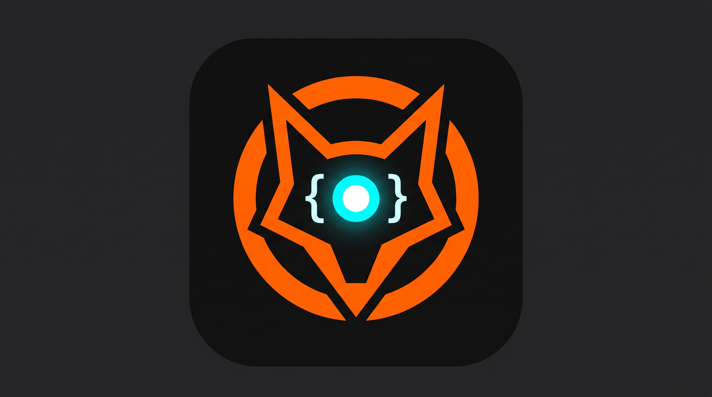

# OmniBrowser

<p align="center">
  
</p>

<p align="center">
  <b>Automatización de navegadores (MCP) para OpenCode y Claude — con un cursor fantasma visible de la IA.</b>
</p>

<p align="center">
  <a href="#-qué-necesitas-descargar">Descargas</a> •
  <a href="#-instalación--linux">Linux</a> •
  <a href="#-instalación--windows">Windows</a> •
  <a href="#-conectar-opencode">OpenCode</a> •
  <a href="#-conectar-claude">Claude</a> •
  <a href="README.md">English</a>
</p>

OmniBrowser conecta [Playwright MCP](https://github.com/microsoft/playwright-mcp) con tu agente de IA para que pueda abrir páginas, leer contenido, hacer clic, rellenar formularios y desplazarse — mientras **ves cada movimiento** gracias a un cursor fantasma morado que flota dentro del navegador.

---

## 📑 Índice

1. [¿Qué es OmniBrowser?](#-qué-es-omnibrowser)
2. [Características](#-características)
3. [El cursor fantasma de la IA](#-el-cursor-fantasma-de-la-ia)
   - [Forma](#forma)
   - [Comportamiento: mover, hacer clic, scroll](#comportamiento-mover-hacer-clic-scroll)
   - [Cómo se inyecta](#cómo-se-inyecta)
   - [API de JavaScript](#api-de-javascript)
   - [Cómo lo maneja el agente](#cómo-lo-maneja-el-agente)
4. [Qué necesitas descargar](#-qué-necesitas-descargar)
   - [Requisitos en Linux](#requisitos-en-linux)
   - [Requisitos en Windows](#requisitos-en-windows)
   - [Opcional: el cliente de IA](#opcional-el-cliente-de-ia)
5. [Instalación](#-instalación)
   - [Linux](#instalar-en-linux)
   - [Windows](#instalar-en-windows)
   - [Qué hacen exactamente los instaladores](#qué-hacen-exactamente-los-instaladores)
6. [Conectar OpenCode](#-conectar-opencode)
7. [Conectar Claude](#-conectar-claude)
8. [Estructura del repositorio](#-estructura-del-repositorio)
9. [Navegadores compatibles](#-navegadores-compatibles)
10. [Firefox frente a Chromium y CDP](#-firefox-frente-a-chromium-y-cdp)
11. [Solución de problemas](#-solución-de-problemas)
12. [Licencia](#-licencia)

---

## 💡 ¿Qué es OmniBrowser?

OmniBrowser es un **paquete de configuración** para servidores de navegador del [Model Context Protocol](https://modelcontextprotocol.io). Da a un agente de IA (OpenCode, Claude Desktop o Claude Code) control total sobre un navegador real — y añade algo que las configuraciones habituales no tienen: **un cursor fantasma morado que te muestra exactamente dónde está apuntando, haciendo clic y desplazándose**.

No es un navegador ni sustituye a uno. Es un conjunto de:

- **archivos de configuración** para Firefox, Brave, Opera, Google Chrome y Chromium;
- **dos instaladores** — `install.sh` (Linux) e `install.ps1` (Windows) — que detectan tus navegadores, generan las configuraciones y registran los servidores MCP en tu cliente;
- **un script de inyección**, `ghost-cursor.js`, que dibuja el puntero de la IA en cada página;
- **esta documentación**.

---

## ✨ Características

| | |
| --- | --- |
| 🖱️ **Puntero visible de la IA** | Un cursor fantasma morado muestra la posición real del agente en todo momento. |
| 🖐️ **Nunca te bloquea** | `pointer-events: none` — el cursor nunca intercepta tus clics. |
| 🔥 **Nunca se oculta** | `z-index: 2147483647` lo coloca por encima de modales, menús y cabeceras fijas. |
| 🎯 **Reacciona al agente** | Se mueve, late cuando el agente hace clic y sigue a la página cuando se desplaza. |
| 🦊 **Cinco navegadores** | Firefox, Brave, Opera, Google Chrome y Chromium. |
| 🐧 **Dos plataformas** | Linux (`install.sh`) y Windows (`install.ps1`). |
| 🤖 **Tres clientes** | OpenCode, Claude Desktop y Claude Code. |
| 🔒 **Seguro por defecto** | Se hace una copia de cada archivo antes de tocarlo y se conservan tus demás servidores MCP. |

---

## 👻 El cursor fantasma de la IA

### Forma

El cursor es un **triángulo minimalista que apunta a la izquierda**, dibujado con un SVG embebido (sin archivos de imagen externos):

- **Forma:** punta aguda a la izquierda, base plana vertical a la derecha, esquinas redondeadas, sin cola ni trazos extra.
- **Color:** morado vibrante `#9D00FF`, con fondo totalmente transparente.
- **Tamaño:** 28 × 28 px, con un resplandor morado suave para que se vea en páginas claras.

El trazado está escrito a mano en `ghost-cursor.js`:

```js
'M20.4 3.2Q21.5 2.4 21.5 3.7L21.5 20.3Q21.5 21.6 20.4 20.8L4.2 13.2Q2.9 12 4.2 10.8Z'
```

Su CSS se aplica directamente al elemento SVG:

```css
position: fixed;
z-index: 2147483647;
pointer-events: none;
transition: top 0.12s ease-out, left 0.12s ease-out, transform 0.1s ease;
```

- `position: fixed` lo ancla al viewport, no al documento.
- `z-index: 2147483647` es el valor entero máximo: flota por encima de cualquier modal.
- `pointer-events: none` garantiza que jamás puede secuestrar tus clics.
- La `transition` suaviza cada movimiento en lugar de teletransportarlo.

### Comportamiento: mover, hacer clic, scroll

| Acción | Qué hace el cursor |
| --- | --- |
| **Mover** | El agente calcula un punto `(x, y)` y el cursor se anima hasta ahí; la **punta** cae exactamente sobre ese punto. |
| **Elemento** | Si el agente apunta a un elemento, el cursor se centra en él. Si está fuera de pantalla, primero se hace scroll para que veas el recorrido. |
| **Clic** | Un clic cerca del puntero dispara un **pulso** rápido (`scale(0.85)` y vuelta). Tus propios clics, lejos del puntero, no disparan nada. |
| **Scroll** | Cuando la página se desplaza, el puntero viaja con el contenido (mismo delta), así ves al agente bajar por la página. Si se desplaza un panel interno, el puntero se acerca a ese panel. |
| **Foco** | Si el elemento que recibe el foco está cerca del puntero, el puntero lo sigue. |
| **Siempre visible** | El cursor está en pantalla desde el primer fotograma de cada página y nunca se aparca fuera del viewport. |

### Cómo se inyecta

Las configuraciones generadas contienen:

```json
{
  "browser": {
    "browserName": "firefox",
    "launchOptions": { "headless": false },
    "initScript": ["ghost-cursor.js"]
  }
}
```

`initScript` es el equivalente en Playwright MCP de **`Page.addScriptToEvaluateOnNewDocument`** de CDP: el script se inyecta *antes* de que se ejecute cualquier script de la página y por tanto **se reinyecta automáticamente en cada navegación y recarga**. No hay que reejecutar nada ni instalar nada página a página.

`ghost-cursor.js` vive junto al archivo de configuración, y las rutas de `initScript` se resuelven respecto al directorio del archivo de configuración.

### API de JavaScript

El script expone una función global:

```js
window.__omnibrowserCursor(x, y);        // mover a coordenadas del viewport
window.__omnibrowserCursor(elemento);    // centrar en un elemento (hace scroll si hace falta)
window.__omnibrowserCursor({ x, y });     // igual que (x, y)

window.__omnibrowserCursor.pulse();       // pulso de clic: escala 0.85 y vuelve
window.__omnibrowserCursor.click(el);     // mover a un elemento + pulso
window.__omnibrowserCursor.scrollTo(y);   // desplazar la página (el puntero la sigue)
window.__omnibrowserCursor.hide();        // ocultar el puntero
window.__omnibrowserCursor.show();        // volver a mostrarlo
window.__omnibrowserCursor.position();    // -> { x, y } posición actual
window.__omnibrowserCursor.isVisible();   // -> booleano
```

### Cómo lo maneja el agente

Sin servidor web, sin puertos, sin websockets: el transporte es la propia herramienta de evaluación del MCP.

```js
// 1. mover a coordenadas exactas
() => window.__omnibrowserCursor(320, 180)

// 2. apuntar a un elemento del snapshot de la página
(el) => window.__omnibrowserCursor(el)

// 3. marcar un clic
() => window.__omnibrowserCursor.pulse()

// 4. ocultar / mostrar
() => window.__omnibrowserCursor.hide()
```

---

## 📥 Qué necesitas descargar

OmniBrowser en sí son solo archivos de configuración. Esto es lo único que debe estar en tu equipo.

### Requisitos en Linux

| Requisito | Para qué | Cómo obtenerlo |
| --- | --- | --- |
| **Node.js 20+** (aporta `npx`) | Playwright MCP es un paquete npm que se lanza con `npx` | [nodejs.org/es/download](https://nodejs.org/es/download) · o `sudo pacman -S nodejs npm` (Arch) · `sudo apt install nodejs npm` (Debian/Ubuntu) |
| **Bash 4+** y **Python 3** | `install.sh` es un script Bash que usa Python 3 para fusionar JSON | Ya están en la mayoría de distros: `sudo pacman -S --needed bash python` · `sudo apt install bash python3` |
| **Sesión gráfica** | El navegador se abre a la vista para que veas el cursor fantasma | Ya la tienes en un escritorio |
| **Un navegador** | El objetivo de la automatización | Enlaces abajo |

> ⚠️ En Debian/Ubuntu el paquete `nodejs` suele ser **anterior a Node 20**. Si el instalador se queja de la versión de Node, instala una versión actual con [NodeSource](https://github.com/nodesource/distributions) o `nvm install --lts`.

**Navegadores compatibles y dónde descargarlos**

| Navegador | Descarga | Motor que usa OmniBrowser |
| --- | --- | --- |
| Mozilla Firefox | [mozilla.org/firefox/new](https://www.mozilla.org/firefox/new/) | Firefox (compilación de Playwright) |
| Google Chrome | [google.com/chrome](https://www.google.com/chrome/) | Chromium (tu instalación) |
| Brave | [brave.com/download](https://brave.com/download/) | Chromium (tu instalación) |
| Opera | [opera.com/download](https://www.opera.com/download) | Chromium (tu instalación) |
| Chromium | [chromium.org](https://www.chromium.org/getting-involved/download-chromium/) | Chromium (tu instalación) |

### Requisitos en Windows

| Requisito | Para qué | Cómo obtenerlo |
| --- | --- | --- |
| **Node.js 20+** (aporta `npx`) | Playwright MCP es un paquete npm que se lanza con `npx` | [nodejs.org/es/download](https://nodejs.org/es/download) · o `winget install OpenJS.NodeJS.LTS` |
| **PowerShell 7** (`pwsh`) | `install.ps1` lo requiere (rechaza Windows PowerShell 5.1) | `winget install Microsoft.PowerShell` · [learn.microsoft.com](https://learn.microsoft.com/powershell/scripting/install/installing-powershell) |
| **Un navegador** | El objetivo de la automatización | Enlaces de la tabla de Linux |

**Dónde busca `install.ps1` tus navegadores**

| Navegador | Rutas comprobadas |
| --- | --- |
| Firefox | `%ProgramFiles%\Mozilla Firefox\firefox.exe`, `%ProgramFiles(x86)\Mozilla Firefox\firefox.exe` |
| Chrome | `%ProgramFiles%\Google\Chrome\Application\chrome.exe`, `%ProgramFiles(x86)\...`, `%LOCALAPPDATA%\Google\Chrome\Application\chrome.exe` |
| Brave | `%LOCALAPPDATA%\BraveSoftware\Brave-Browser\Application\brave.exe`, `%ProgramFiles%\BraveSoftware\...` |
| Opera | `%LOCALAPPDATA%\Programs\Opera\opera.exe`, `%LOCALAPPDATA%\Programs\Opera GX\opera.exe`, `%ProgramFiles%\Opera\opera.exe` |
| Chromium | `%LOCALAPPDATA%\Chromium\Application\chrome.exe`, `%ProgramFiles%\Chromium\Application\chrome.exe` |

Si tu navegador está en otra ruta, añade su carpeta al `PATH` y el instalador lo encontrará igualmente.

### Opcional: el cliente de IA

OmniBrowser funciona con cualquier cliente compatible con MCP. Estos son los documentados aquí:

| Cliente | Instalación | Documentación |
| --- | --- | --- |
| **OpenCode** | `curl -fsSL https://opencode.ai/v2/install \| bash` · `npm install -g @opencode/cli` · `paru -S opencode-beta` | [opencode.ai/docs](https://opencode.ai/docs/) |
| **Claude Code** | `curl -fsSL https://claude.ai/install.sh \| bash` (Linux/macOS) · `irm https://claude.ai/install.ps1 \| iex` (Windows) · `winget install Anthropic.ClaudeCode` | [code.claude.com/docs](https://code.claude.com/docs/en/overview) |
| **Claude Desktop** | [claude.com/download](https://claude.com/download) (app de Windows/macOS) | [code.claude.com/docs/en/desktop](https://code.claude.com/docs/en/desktop-quickstart) |

---

## 🛠️ Instalación

### Instalar en Linux

```bash
git clone https://github.com/EDER1002/OmniBrowser-.git
cd OmniBrowser-
chmod +x install.sh
./install.sh
```

Si encuentra un solo navegador lo configura automáticamente; si encuentra varios, muestra un menú interactivo.

```bash
./install.sh --all             # registrar todos los navegadores detectados
./install.sh --browser brave   # registrar solo Brave
./install.sh --claude          # registrar además los servidores en Claude
./install.sh --help            # ayuda completa
```

### Instalar en Windows

Abre **PowerShell 7** (`pwsh`) en la carpeta del repositorio:

```powershell
git clone https://github.com/EDER1002/OmniBrowser-.git
cd OmniBrowser-
pwsh -ExecutionPolicy Bypass -File .\install.ps1
```

> `-ExecutionPolicy Bypass` solo afecta a esta ejecución. Windows bloquea por defecto los scripts de PowerShell; este flag permite ejecutar el instalador una vez.

Mismas opciones que en Linux, como parámetros:

```powershell
.\install.ps1 -All                # registrar todos los navegadores detectados
.\install.ps1 -Browser brave      # registrar solo Brave
.\install.ps1 -Claude             # registrar además en Claude Desktop / Claude Code
.\install.ps1 -Help               # ayuda completa
```

### Qué hacen exactamente los instaladores

1. **Detectan** qué navegadores compatibles hay instalados (y la ruta exacta del ejecutable).
2. **Crean** `~/.config/opencode/omnibrowser/` y copian allí `ghost-cursor.js`.
3. **Escriben** una configuración por navegador, p. ej. `mcp-firefox-config.json`, cada una con el `initScript` que inyecta el cursor fantasma.
4. **Registran** los servidores en la configuración de tu cliente, reemplazando solo las entradas de OmniBrowser (`omnibrowser-*` y la antigua `firefox-playwright`) y dejando intactos el resto de servidores MCP.
5. **Hacen una copia de seguridad** (`config.json.bak-<fecha y hora>`) de cualquier archivo que modifican.

| Cliente | Archivo de configuración |
| --- | --- |
| OpenCode | `~/.config/opencode/opencode.json` (Linux, macOS y Windows) — `${XDG_CONFIG_HOME:-~/.config}/opencode/opencode.json` en Linux si defines `XDG_CONFIG_HOME` |
| Claude Desktop | Windows: `%APPDATA%\Claude\claude_desktop_config.json` · macOS: `~/Library/Application Support/Claude/claude_desktop_config.json` · Linux: `~/.config/Claude/claude_desktop_config.json` (solo si ya existe) |
| Claude Code | `claude mcp add ...` (ámbito de usuario) o un archivo `.mcp.json` en el proyecto |

---

## 🔌 Conectar OpenCode

OpenCode guarda su configuración global en `~/.config/opencode/opencode.json(c)` en **todos** los sistemas operativos.

Los servidores MCP locales van dentro de `mcp.servers` y usan **un único arreglo `command`** con todos los argumentos. OpenCode no tiene una propiedad `args` aparte.

```json
{
  "$schema": "https://opencode.ai/config.json",
  "mcp": {
    "servers": {
      "omnibrowser-firefox": {
        "type": "local",
        "command": [
          "npx",
          "-y",
          "@playwright/mcp@latest",
          "--config",
          "/home/usuario/.config/opencode/omnibrowser/mcp-firefox-config.json"
        ],
        "timeout": { "startup": 60000, "catalog": 30000 }
      }
    }
  }
}
```

`opencode.example.json` contiene las cinco entradas posibles, deshabilitadas por defecto.

**Final:** reinicia OpenCode y ejecuta `/mcps` para comprobar que el servidor aparece como conectado.

---

## 🤖 Conectar Claude

Claude usa otra estructura: `mcpServers`, con `command` como **string** y los argumentos en `args`.

```json
{
  "mcpServers": {
    "omnibrowser-firefox": {
      "command": "npx",
      "args": [
        "-y",
        "@playwright/mcp@latest",
        "--config",
        "/ABSOLUTE/PATH/TO/omnibrowser/mcp-firefox-config.json"
      ]
    }
  }
}
```

### Claude Desktop

- **Windows:** `.\install.ps1 -Claude` crea o fusiona `%APPDATA%\Claude\claude_desktop_config.json` por ti (con copia de seguridad).
- **Linux:** `./install.sh --claude` fusiona el archivo **solo si ya existe**; si no, imprime los comandos listos para Claude Code.
- **macOS:** fusiona `claude.example.json` en `~/Library/Application Support/Claude/claude_desktop_config.json` y sustituye `/ABSOLUTE/PATH/TO/` por tu ruta real.

Después reinicia Claude Desktop; los servidores MCP aparecen bajo el icono de herramientas.

> En Windows, Claude Desktop a veces no encuentra `npx`. Sustituye `"command": "npx"` por `"command": "cmd"` y añade `"/c", "npx"` al principio de `args`.

### Claude Code

Registra cada servidor desde la CLI (una línea por navegador):

```bash
claude mcp add omnibrowser-firefox -- npx -y @playwright/mcp@latest --config "$HOME/.config/opencode/omnibrowser/mcp-firefox-config.json"
```

Ambos instaladores imprimen estos comandos exactos cuando les pasas `--claude` / `-Claude`. También puedes copiar `claude.example.json` como `.mcp.json` en un proyecto: Claude Code lee la misma estructura `mcpServers`.

---

## 📂 Estructura del repositorio

```text
OmniBrowser/
├── configs/                       # Plantillas de referencia (rutas de Linux)
│   ├── windows/                   # Plantillas de referencia (rutas de Windows)
│   │   ├── mcp-chrome-config.json
│   │   ├── mcp-brave-config.json
│   │   ├── mcp-opera-config.json
│   │   └── mcp-chromium-config.json
│   ├── mcp-firefox-config.json
│   ├── mcp-brave-config.json
│   ├── mcp-opera-config.json
│   ├── mcp-chrome-config.json
│   ├── mcp-chromium-config.json
│   └── mcp-chromium-cdp.example.json
├── ghost-cursor.js                # El cursor fantasma de la IA (SVG + comportamiento)
├── install.sh                     # Instalador para Linux
├── install.ps1                    # Instalador para Windows (PowerShell 7)
├── mcp-firefox-config.json        # Configuración de referencia en la raíz
├── opencode.example.json          # Ejemplo de registro en OpenCode
├── claude.example.json            # Ejemplo de registro en Claude Desktop / Code
├── logo.png
├── LICENSE
└── README.md
```

> Los archivos de `configs/` son **ejemplos de referencia**. No los copies tal cual a tu directorio de configuración (sus rutas relativas de `initScript` dejarían de resolver); ejecuta el instalador, que escribe las configuraciones definitivas con `ghost-cursor.js` al lado.

---

## 🌐 Navegadores compatibles

| Navegador | Motor | Ejecutable | Notas |
| --- | --- | --- | --- |
| Firefox | `firefox` | compilación propia de Playwright | Playwright trae un Firefox parcheado; no se usa tu Firefox habitual. |
| Brave | `chromium` | ruta detectada | `launchOptions.executablePath` se rellena automáticamente. |
| Opera | `chromium` | ruta detectada | Igual, incluido Opera GX. |
| Google Chrome | `chromium` | ruta detectada | Igual. |
| Chromium | `chromium` | ruta detectada | Igual. |

---

## ⚙️ Firefox frente a Chromium y CDP

Hay dos formas distintas de trabajar con un navegador y no deben confundirse.

### 1. Playwright inicia el navegador (modo predeterminado)

Es el modo que configuran los instaladores.

- **Firefox** usa `browserName: "firefox"`. Playwright descarga y maneja su propia compilación de Firefox, que habla su protocolo de automatización; **no** se conecta a tu Firefox normal.
- **Brave, Opera, Chrome y Chromium** usan `browserName: "chromium"` más `launchOptions.executablePath` con la ruta detectada.
- **No hace falta `--remote-debugging-port=9222`** aquí: Playwright inicia y gestiona el navegador por sí mismo.

### 2. Conectarse a un Chromium que abriste tú (CDP opcional)

Solo necesitas el puerto de depuración cuando quieras que MCP se conecte a una instancia que lanzaste tú:

```bash
mkdir -p "$HOME/.cache/omnibrowser/brave-cdp-profile"
brave --remote-debugging-port=9222 \
  --user-data-dir="$HOME/.cache/omnibrowser/brave-cdp-profile"
```

Sustituye `brave` por `opera`, `google-chrome` o `chromium` según corresponda y usa una configuración con `cdpEndpoint`:

```json
{
  "browser": {
    "browserName": "chromium",
    "cdpEndpoint": "http://127.0.0.1:9222",
    "initScript": ["ghost-cursor.js"]
  }
}
```

Hay un ejemplo listo en `configs/mcp-chromium-cdp.example.json`. Usa un perfil separado para esta sesión y no expongas el puerto de depuración a redes no confiables.

**Firefox no puede usar el endpoint CDP de Chromium.** Para Firefox, usa el modo de lanzamiento gestionado por Playwright.

---

## 🔧 Solución de problemas

**El servidor MCP no aparece en OpenCode / Claude**
Reinicia el cliente y revisa `/mcps` (OpenCode) o el icono de herramientas (Claude Desktop). Comprueba que `npx` funciona en la misma sesión de usuario: `npx --version`.

**"Chromium distribution 'chrome' is not found"**
El servidor arrancó sin el argumento `--config`. En OpenCode, todos los argumentos van dentro del arreglo `command` — no existe una propiedad `args`:

```json
"command": ["npx", "-y", "@playwright/mcp@latest", "--config", "/ruta/absoluta/mcp-chrome-config.json"]
```

**No se detecta el navegador**
Comprueba que el ejecutable esté en el `PATH` (`command -v firefox` en Linux, `$env:PATH` en Windows). En Windows revisa también las rutas estándar de la sección [Requisitos en Windows](#requisitos-en-windows).

**Ruta del binario incorrecta en la configuración**
Abre `~/.config/opencode/omnibrowser/mcp-<navegador>-config.json` y revisa `launchOptions.executablePath`. Si vuelves a ejecutar el instalador, se regenera el archivo con la ruta correcta.

**El cursor fantasma no aparece**
1. Comprueba que la configuración contiene `"initScript": ["ghost-cursor.js"]`.
2. Comprueba que `ghost-cursor.js` existe **junto al archivo de configuración** (mismo directorio).
3. Reinicia el servidor MCP (en OpenCode: `/mcps` → reconectar).
4. Si borraste el script pero dejaste `initScript` en la configuración, Playwright no puede crear el contexto del navegador y **todas** las herramientas dejan de funcionar. Quita primero la clave `initScript` y luego borra el archivo.

**El cursor fantasma no se mueve**
El agente debe llamar a `window.__omnibrowserCursor(x, y)` mediante la herramienta de evaluación del MCP antes de actuar. Revisa el registro de herramientas del agente buscando una llamada a `browser_evaluate`.

**El cursor queda por encima de un modal**
Es intencionado: `z-index: 2147483647` es el valor máximo para que el puntero nunca quede oculto por un diálogo.

**El puerto CDP 9222 está ocupado**
Otra instancia de Chrome/Chromium lo tiene. Ciérrala o usa otro puerto:

```bash
ss -ltnp | grep 9222              # Linux: quién lo ocupa
google-chrome --remote-debugging-port=9223
```

Y apunta `cdpEndpoint` al nuevo puerto.

**Errores de versión de Node**
Playwright MCP necesita Node 20 o superior. Comprueba con `node --version`; en Windows instala con `winget install OpenJS.NodeJS.LTS`.

**Firefox falla al arrancar la primera vez**
Playwright descarga su compilación del navegador bajo demanda: revisa tu conexión o instálala a mano:

```bash
npx playwright install firefox
```

**PowerShell bloquea install.ps1 (Windows)**
Ejecuta `pwsh -ExecutionPolicy Bypass -File .\install.ps1`. Si dice que requiere PowerShell 7, instálalo con `winget install Microsoft.PowerShell`.

**"Este instalador requiere PowerShell 7" (Windows)**
`powershell` es Windows PowerShell 5.1; el script necesita `pwsh` (PowerShell 7). Instálalo con `winget install Microsoft.PowerShell` y repite el comando con `pwsh`.

**JSON inválido en la configuración del cliente**
Ambos instaladores se detienen sin sobrescribir el archivo. Corrígelo manualmente y vuelve a ejecutar el instalador; la versión anterior queda como `config.json.bak-<fecha y hora>`.

**Claude Desktop no arranca el servidor en Windows**
Sustituye `"command": "npx"` por `"command": "cmd"` y pon `"/c", "npx"` al principio de `args`.

---

## 📄 Licencia

Distribuido bajo la licencia **GPL-2.0**. Consulta [`LICENSE`](LICENSE) para más detalles.
