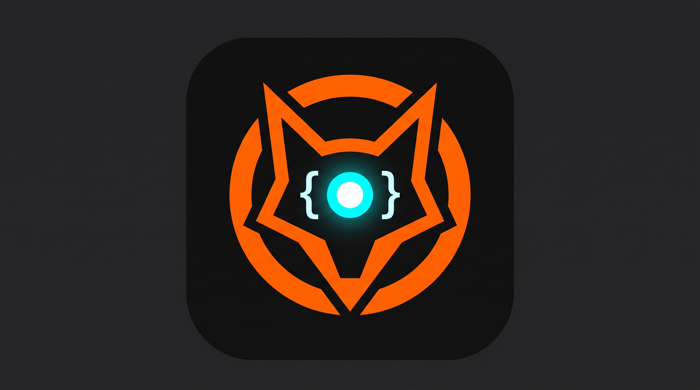

# OmniBrowser

<p align="center">
  
</p>

<p align="center">
  <b>Browser automation (MCP) for OpenCode and Claude — with a visible AI ghost cursor.</b>
</p>

<p align="center">
  <a href="#-what-you-need-to-download">Downloads</a> •
  <a href="#-installation--linux">Linux</a> •
  <a href="#-installation--windows">Windows</a> •
  <a href="#-connect-opencode">OpenCode</a> •
  <a href="#-connect-claude">Claude</a> •
  <a href="README.es.md">Español</a>
</p>

OmniBrowser wires [Playwright MCP](https://github.com/microsoft/playwright-mcp) into your AI coding agent so it can open pages, read content, click, fill forms and scroll — while you **watch every move** through a purple ghost cursor that floats inside the browser.

---

## 📑 Table of contents

1. [What is OmniBrowser?](#-what-is-omnibrowser)
2. [Key features](#-key-features)
3. [The AI ghost cursor](#-the-ai-ghost-cursor)
   - [Appearance](#appearance)
   - [Behaviour: move, click, scroll](#behaviour-move-click-scroll)
   - [How it is injected](#how-it-is-injected)
   - [JavaScript API](#javascript-api)
   - [How the agent drives it](#how-the-agent-drives-it)
4. [What you need to download](#-what-you-need-to-download)
   - [Linux requirements](#linux-requirements)
   - [Windows requirements](#windows-requirements)
   - [Optional: the AI client](#optional-the-ai-client)
5. [Installation](#-installation)
   - [Linux](#install-on-linux)
   - [Windows](#install-on-windows)
   - [What the installers actually do](#what-the-installers-actually-do)
6. [Connect OpenCode](#-connect-opencode)
7. [Connect Claude](#-connect-claude)
8. [Repository layout](#-repository-layout)
9. [Browser support](#-browser-support)
10. [Firefox vs Chromium and CDP](#-firefox-vs-chromium-and-cdp)
11. [Troubleshooting](#-troubleshooting)
12. [License](#-license)

---

## 💡 What is OmniBrowser?

OmniBrowser is a **configuration pack** for [Model Context Protocol](https://modelcontextprotocol.io) browser servers. It gives an AI agent (OpenCode, Claude Desktop or Claude Code) full control of a real browser — and adds one thing generic setups don't have: **a purple ghost cursor that shows you exactly where the AI is pointing, clicking and scrolling.**

It is not a browser and it does not replace one. It is a set of:

- **browser configuration files** for Firefox, Brave, Opera, Google Chrome and Chromium;
- **two installers** — `install.sh` (Linux) and `install.ps1` (Windows) — that detect your browsers, generate the configs and register the MCP servers in your client;
- **one injection script**, `ghost-cursor.js`, that draws the AI pointer inside every page;
- **this documentation**.

---

## ✨ Key features

| | |
| --- | --- |
| 🖱️ **Visible AI pointer** | A purple ghost cursor shows the agent's real-time position. You always know where it is looking. |
| 🖐️ **Never blocks you** | `pointer-events: none` — the cursor never intercepts your own clicks. |
| 🔥 **Never hides** | `z-index: 2147483647` puts it above modals, menus and sticky headers. |
| 🎯 **Reacts to the agent** | It moves, pulses when the agent clicks and follows the page when it scrolls. |
| 🦊 **Five browsers** | Firefox, Brave, Opera, Google Chrome and Chromium. |
| 🐧 **Two platforms** | Linux (`install.sh`) and Windows (`install.ps1`). |
| 🤖 **Three clients** | OpenCode, Claude Desktop and Claude Code. |
| 🔒 **Safe by default** | Every config file is backed up before it is touched, and your other MCP servers are preserved. |

---

## 👻 The AI ghost cursor

### Appearance

The cursor is a **minimalist triangle pointing left**, drawn with an inline SVG (no external image files):

- **Shape:** acute tip on the left, flat vertical base on the right, rounded corners, no tail, no extra strokes.
- **Colour:** vibrant purple `#9D00FF`, fully transparent background.
- **Size:** 28 × 28 px, with a soft purple glow so it stays visible on light pages.

The path is written by hand in `ghost-cursor.js`:

```js
'M20.4 3.2Q21.5 2.4 21.5 3.7L21.5 20.3Q21.5 21.6 20.4 20.8L4.2 13.2Q2.9 12 4.2 10.8Z'
```

Its CSS is applied directly to the SVG element:

```css
position: fixed;
z-index: 2147483647;
pointer-events: none;
transition: top 0.12s ease-out, left 0.12s ease-out, transform 0.1s ease;
```

- `position: fixed` keeps it anchored to the viewport, not to the document.
- `z-index: 2147483647` is the maximum integer value — it floats above every modal.
- `pointer-events: none` guarantees it can never swallow your clicks.
- The `transition` makes every movement smooth instead of teleporting.

### Behaviour: move, click, scroll

| Action | What the cursor does |
| --- | --- |
| **Move** | The agent computes a point `(x, y)` and the cursor animates there; the **tip** lands exactly on that point. |
| **Element** | If the agent points at an element, the cursor centres on it. If the element is off-screen it is first scrolled into view, so you see the page travel. |
| **Click** | A click near the pointer triggers a quick **pulse** (`scale(0.85)` and back). Your own clicks, far from the pointer, trigger nothing. |
| **Scroll** | When the page scrolls, the pointer travels with the content (same delta), so you can see the agent going down the page. When an inner panel scrolls, the pointer moves towards that panel. |
| **Focus** | If the focused element is close to the pointer, the pointer follows it. |
| **Always visible** | The cursor is on screen from the first frame of every page and is never parked outside the viewport. |

### How it is injected

The generated browser configs contain:

```json
{
  "browser": {
    "browserName": "firefox",
    "launchOptions": { "headless": false },
    "initScript": ["ghost-cursor.js"]
  }
}
```

`initScript` is Playwright MCP's equivalent of CDP's **`Page.addScriptToEvaluateOnNewDocument`**: the script is injected *before* any page script runs, and therefore **automatically re-injected on every navigation and reload**. There is nothing to re-run and nothing to install per page.

`ghost-cursor.js` lives next to the config file, and `initScript` paths are resolved relative to the config file's directory.

### JavaScript API

The script exposes one global function:

```js
window.__omnibrowserCursor(x, y);        // move to viewport coordinates
window.__omnibrowserCursor(element);     // centre on an element (scrolls it into view)
window.__omnibrowserCursor({ x, y });     // same as (x, y)

window.__omnibrowserCursor.pulse();       // click pulse: scale 0.85 and back
window.__omnibrowserCursor.click(el);     // move to an element + pulse
window.__omnibrowserCursor.scrollTo(y);   // scroll the page (the pointer follows)
window.__omnibrowserCursor.hide();        // hide the pointer
window.__omnibrowserCursor.show();        // show it again
window.__omnibrowserCursor.position();    // -> { x, y } current position
window.__omnibrowserCursor.isVisible();   // -> boolean
```

### How the agent drives it

No web server, no ports, no websockets: the transport is the MCP evaluation tool itself.

```js
// 1. move to exact coordinates
() => window.__omnibrowserCursor(320, 180)

// 2. point at an element from the page snapshot
(el) => window.__omnibrowserCursor(el)

// 3. mark a click
() => window.__omnibrowserCursor.pulse()

// 4. hide / show
() => window.__omnibrowserCursor.hide()
```

---

## 📥 What you need to download

OmniBrowser itself is just configuration files. These are the only things you must have on your machine.

### Linux requirements

| Requirement | Why | How to get it |
| --- | --- | --- |
| **Node.js 20+** (provides `npx`) | Playwright MCP is an npm package launched through `npx` | [nodejs.org/en/download](https://nodejs.org/en/download) · or `sudo pacman -S nodejs npm` (Arch) · `sudo apt install nodejs npm` (Debian/Ubuntu) |
| **Bash 4+** and **Python 3** | `install.sh` is a Bash script that uses Python 3 for JSON merging | Already installed on most distros: `sudo pacman -S --needed bash python` · `sudo apt install bash python3` |
| **A graphical session** | The browser opens visibly so you can watch the ghost cursor | You are already on a desktop environment |
| **One browser** | The automation target | See the links below |

> ⚠️ On Debian/Ubuntu the packaged `nodejs` is often **older than Node 20**. If the installer complains about the Node version, install a current release with [NodeSource](https://github.com/nodesource/distributions) or `nvm install --lts`.

**Supported browsers and where to download them**

| Browser | Download | Engine used by OmniBrowser |
| --- | --- | --- |
| Mozilla Firefox | [mozilla.org/firefox/new](https://www.mozilla.org/firefox/new/) | Firefox (Playwright build) |
| Google Chrome | [google.com/chrome](https://www.google.com/chrome/) | Chromium (your install) |
| Brave | [brave.com/download](https://brave.com/download/) | Chromium (your install) |
| Opera | [opera.com/download](https://www.opera.com/download) | Chromium (your install) |
| Chromium | [chromium.org](https://www.chromium.org/getting-involved/download-chromium/) | Chromium (your install) |

### Windows requirements

| Requirement | Why | How to get it |
| --- | --- | --- |
| **Node.js 20+** (provides `npx`) | Playwright MCP is an npm package launched through `npx` | [nodejs.org/en/download](https://nodejs.org/en/download) · or `winget install OpenJS.NodeJS.LTS` |
| **PowerShell 7** (`pwsh`) | `install.ps1` requires it (Windows PowerShell 5.1 is rejected) | `winget install Microsoft.PowerShell` · [learn.microsoft.com](https://learn.microsoft.com/powershell/scripting/install/installing-powershell) |
| **One browser** | The automation target | See the links in the Linux table above |

**Where `install.ps1` looks for your browsers**

| Browser | Paths checked |
| --- | --- |
| Firefox | `%ProgramFiles%\Mozilla Firefox\firefox.exe`, `%ProgramFiles(x86)\Mozilla Firefox\firefox.exe` |
| Chrome | `%ProgramFiles%\Google\Chrome\Application\chrome.exe`, `%ProgramFiles(x86)\...`, `%LOCALAPPDATA%\Google\Chrome\Application\chrome.exe` |
| Brave | `%LOCALAPPDATA%\BraveSoftware\Brave-Browser\Application\brave.exe`, `%ProgramFiles%\BraveSoftware\...` |
| Opera | `%LOCALAPPDATA%\Programs\Opera\opera.exe`, `%LOCALAPPDATA%\Programs\Opera GX\opera.exe`, `%ProgramFiles%\Opera\opera.exe` |
| Chromium | `%LOCALAPPDATA%\Chromium\Application\chrome.exe`, `%ProgramFiles%\Chromium\Application\chrome.exe` |

If your browser lives somewhere else, add its folder to `PATH` and the installer will still find it.

### Optional: the AI client

OmniBrowser works with any MCP-capable client. These are the ones documented here:

| Client | Install | Docs |
| --- | --- | --- |
| **OpenCode** | `curl -fsSL https://opencode.ai/v2/install \| bash` · `npm install -g @opencode/cli` · `paru -S opencode-beta` | [opencode.ai/docs](https://opencode.ai/docs/) |
| **Claude Code** | `curl -fsSL https://claude.ai/install.sh \| bash` (Linux/macOS) · `irm https://claude.ai/install.ps1 \| iex` (Windows) · `winget install Anthropic.ClaudeCode` | [code.claude.com/docs](https://code.claude.com/docs/en/overview) |
| **Claude Desktop** | [claude.com/download](https://claude.com/download) (Windows/macOS app) | [code.claude.com/docs/en/desktop](https://code.claude.com/docs/en/desktop-quickstart) |

---

## 🛠️ Installation

### Install on Linux

```bash
git clone https://github.com/EDER1002/OmniBrowser-.git
cd OmniBrowser-
chmod +x install.sh
./install.sh
```

If a single browser is found it is configured automatically; if several are found you get an interactive menu.

```bash
./install.sh --all             # register every detected browser
./install.sh --browser brave   # register only Brave
./install.sh --claude          # also register the servers in Claude
./install.sh --help            # full help
```

### Install on Windows

Open **PowerShell 7** (`pwsh`) in the repository folder:

```powershell
git clone https://github.com/EDER1002/OmniBrowser-.git
cd OmniBrowser-
pwsh -ExecutionPolicy Bypass -File .\install.ps1
```

> `-ExecutionPolicy Bypass` only affects this single execution. Windows blocks PowerShell scripts by default; this flag lets the installer run once.

Same options as Linux, as parameters:

```powershell
.\install.ps1 -All                # register every detected browser
.\install.ps1 -Browser brave      # register only Brave
.\install.ps1 -Claude             # also register in Claude Desktop / Claude Code
.\install.ps1 -Help               # full help
```

### What the installers actually do

1. **Detect** which supported browsers are installed (and their exact executable path).
2. **Create** `~/.config/opencode/omnibrowser/` and copy `ghost-cursor.js` into it.
3. **Write** one config per browser, e.g. `mcp-firefox-config.json`, each containing the `initScript` that injects the ghost cursor.
4. **Register** the servers in your client's configuration, replacing only OmniBrowser's own entries (`omnibrowser-*` and the legacy `firefox-playwright`) and leaving every other MCP server untouched.
5. **Back up** any file it modifies as `config.json.bak-<timestamp>` before writing.

| Client | Configuration file |
| --- | --- |
| OpenCode | `~/.config/opencode/opencode.json` (Linux, macOS and Windows) — `${XDG_CONFIG_HOME:-~/.config}/opencode/opencode.json` on Linux if you set `XDG_CONFIG_HOME` |
| Claude Desktop | Windows: `%APPDATA%\Claude\claude_desktop_config.json` · macOS: `~/Library/Application Support/Claude/claude_desktop_config.json` · Linux: `~/.config/Claude/claude_desktop_config.json` (only if it already exists) |
| Claude Code | `claude mcp add ...` (user scope) or a project `.mcp.json` file |

---

## 🔌 Connect OpenCode

OpenCode stores its global configuration in `~/.config/opencode/opencode.json(c)` on **every** operating system.

Local MCP servers live under `mcp.servers` and take **a single `command` array** containing every argument. OpenCode has no separate `args` property.

```json
{
  "$schema": "https://opencode.ai/config.json",
  "mcp": {
    "servers": {
      "omnibrowser-firefox": {
        "type": "local",
        "command": [
          "npx",
          "-y",
          "@playwright/mcp@latest",
          "--config",
          "/home/user/.config/opencode/omnibrowser/mcp-firefox-config.json"
        ],
        "timeout": { "startup": 60000, "catalog": 30000 }
      }
    }
  }
}
```

`opencode.example.json` contains all five possible entries, disabled by default.

**Finish:** restart OpenCode and run `/mcps` to check that the server shows up as connected.

---

## 🤖 Connect Claude

Claude uses a different structure: `mcpServers`, with `command` as a **string** and the arguments in `args`.

```json
{
  "mcpServers": {
    "omnibrowser-firefox": {
      "command": "npx",
      "args": [
        "-y",
        "@playwright/mcp@latest",
        "--config",
        "/ABSOLUTE/PATH/TO/omnibrowser/mcp-firefox-config.json"
      ]
    }
  }
}
```

### Claude Desktop

- **Windows:** `.\install.ps1 -Claude` creates or merges `%APPDATA%\Claude\claude_desktop_config.json` for you (with a backup).
- **Linux:** `./install.sh --claude` merges the file **only if it already exists**; otherwise it prints ready-to-paste Claude Code commands instead.
- **macOS:** merge `claude.example.json` into `~/Library/Application Support/Claude/claude_desktop_config.json` and replace `/ABSOLUTE/PATH/TO/` with your real path.

Restart Claude Desktop afterwards; the MCP servers appear under the tools icon.

> On Windows Claude Desktop sometimes cannot resolve `npx`. Replace `"command": "npx"` with `"command": "cmd"` and add `"/c", "npx"` at the beginning of `args`.

### Claude Code

Register each server from the CLI (one line per browser):

```bash
claude mcp add omnibrowser-firefox -- npx -y @playwright/mcp@latest --config "$HOME/.config/opencode/omnibrowser/mcp-firefox-config.json"
```

Both installers print these exact commands when you pass `--claude` / `-Claude`. You can also copy `claude.example.json` to a project as `.mcp.json` — Claude Code reads the same `mcpServers` structure.

---

## 📂 Repository layout

```text
OmniBrowser/
├── configs/                       # Reference templates (Linux paths)
│   ├── windows/                   # Reference templates (Windows paths)
│   │   ├── mcp-chrome-config.json
│   │   ├── mcp-brave-config.json
│   │   ├── mcp-opera-config.json
│   │   └── mcp-chromium-config.json
│   ├── mcp-firefox-config.json
│   ├── mcp-brave-config.json
│   ├── mcp-opera-config.json
│   ├── mcp-chrome-config.json
│   ├── mcp-chromium-config.json
│   └── mcp-chromium-cdp.example.json
├── ghost-cursor.js                # The AI ghost cursor (inline SVG + behaviour)
├── install.sh                     # Installer for Linux
├── install.ps1                    # Installer for Windows (PowerShell 7)
├── mcp-firefox-config.json        # Reference config in the repository root
├── opencode.example.json          # OpenCode registration example
├── claude.example.json            # Claude Desktop / Claude Code example
├── logo.png
├── LICENSE
└── README.md
```

> The files in `configs/` are **reference examples**. Do not copy them into your configuration directory as-is (their relative `initScript` paths would stop resolving); run the installer, which writes the definitive configs with `ghost-cursor.js` next to them.

---

## 🌐 Browser support

| Browser | Engine | Executable | Notes |
| --- | --- | --- | --- |
| Firefox | `firefox` | Playwright's own build | Playwright ships a patched Firefox; your normal Firefox install is not used. |
| Brave | `chromium` | detected path | `launchOptions.executablePath` is filled automatically. |
| Opera | `chromium` | detected path | Same, including Opera GX. |
| Google Chrome | `chromium` | detected path | Same. |
| Chromium | `chromium` | detected path | Same. |

---

## ⚙️ Firefox vs Chromium and CDP

There are two different ways to work with a browser, and they must not be mixed up.

### 1. Playwright launches the browser (default)

This is the mode configured by the installers.

- **Firefox** uses `browserName: "firefox"`. Playwright downloads and drives its own Firefox build, which speaks its automation protocol; it does **not** attach to your regular Firefox.
- **Brave, Opera, Chrome and Chromium** use `browserName: "chromium"` plus `launchOptions.executablePath` pointing at the detected binary.
- **You do not need `--remote-debugging-port=9222`** here: Playwright starts and manages the browser itself.

### 2. Attaching to a Chromium you started yourself (optional CDP)

You only need the debugging port when you want MCP to connect to an instance you launched:

```bash
mkdir -p "$HOME/.cache/omnibrowser/brave-cdp-profile"
brave --remote-debugging-port=9222 \
  --user-data-dir="$HOME/.cache/omnibrowser/brave-cdp-profile"
```

Replace `brave` with `opera`, `google-chrome` or `chromium` as needed, then use a config with `cdpEndpoint`:

```json
{
  "browser": {
    "browserName": "chromium",
    "cdpEndpoint": "http://127.0.0.1:9222",
    "initScript": ["ghost-cursor.js"]
  }
}
```

A ready-made example lives in `configs/mcp-chromium-cdp.example.json`. Use a separate profile for this session and never expose the debugging port to untrusted networks.

**Firefox cannot use Chromium's CDP endpoint.** For Firefox, use Playwright's managed launch mode.

---

## 🔧 Troubleshooting

**The MCP server does not appear in OpenCode / Claude**
Restart the client and check `/mcps` (OpenCode) or the tools icon (Claude Desktop). Make sure `npx` works in the same user session: `npx --version`.

**"Chromium distribution 'chrome' is not found"**
The server started without the `--config` argument. In OpenCode, every argument must be inside the `command` array — there is no `args` property:

```json
"command": ["npx", "-y", "@playwright/mcp@latest", "--config", "/absolute/path/mcp-chrome-config.json"]
```

**The browser is not detected**
Check that the executable is in `PATH` (`command -v firefox` on Linux, `$env:PATH` on Windows). On Windows also check the standard locations listed in [Windows requirements](#windows-requirements).

**Wrong binary path in the config**
Open `~/.config/opencode/omnibrowser/mcp-<browser>-config.json` and check `launchOptions.executablePath`. Re-running the installer regenerates the file with the correct path.

**The ghost cursor does not appear**
1. Confirm the config contains `"initScript": ["ghost-cursor.js"]`.
2. Confirm `ghost-cursor.js` exists **next to the config file** (same directory).
3. Restart the MCP server (in OpenCode: `/mcps` → reconnect).
4. If you deleted the script but left `initScript` in place, Playwright fails to create the browser context and **every** browser tool stops working. Remove the `initScript` key first, then delete the file.

**The ghost cursor does not move**
The agent must call `window.__omnibrowserCursor(x, y)` through the MCP evaluation tool before acting. Check the agent's tool log for a `browser_evaluate` call.

**The cursor is above a modal / always on top**
That is intentional: `z-index: 2147483647` is the maximum value so the pointer is never hidden by a dialog.

**CDP port 9222 is already in use**
Another Chrome/Chromium instance holds it. Close it or pick another port:

```bash
ss -ltnp | grep 9222              # Linux: who is using it
google-chrome --remote-debugging-port=9223
```

Then point `cdpEndpoint` to the new port.

**Node version errors**
Playwright MCP needs Node 20 or newer. Check with `node --version`; on Windows install with `winget install OpenJS.NodeJS.LTS`.

**Firefox fails to start the first time**
Playwright downloads its browser build on demand — check your internet connection, or install it manually:

```bash
npx playwright install firefox
```

**PowerShell blocks install.ps1 (Windows)**
Run `pwsh -ExecutionPolicy Bypass -File .\install.ps1`. If it says PowerShell 7 is required, install it with `winget install Microsoft.PowerShell`.

**"This installer requires PowerShell 7" (Windows)**
`powershell` is Windows PowerShell 5.1; the script needs `pwsh` (PowerShell 7). Install it with `winget install Microsoft.PowerShell` and re-run the command with `pwsh`.

**Invalid JSON in the client configuration**
Both installers stop without overwriting the file. Fix it manually and run the installer again; the previous version is kept as `config.json.bak-<timestamp>`.

**Claude Desktop cannot start the server on Windows**
Replace `"command": "npx"` with `"command": "cmd"` and put `"/c", "npx"` at the start of `args`.

---

## 📄 License

Distributed under the **GPL-2.0** license. See [`LICENSE`](LICENSE) for details.
